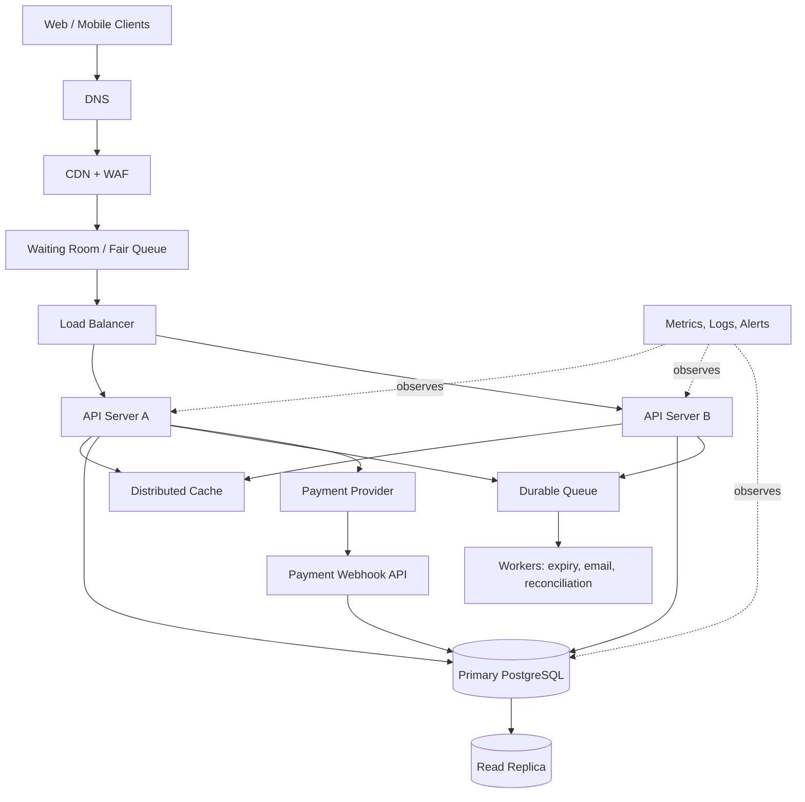

# TicketHub: Ticketing System Design

## 1. Requirements

### Functional requirements

- Visitors can browse and search events by name, artist, venue, date, and location.
- Visitors can view an event's seat map, prices, and current seat availability.
- Signed-in users can temporarily hold available seats, pay, and receive a confirmed order and ticket.
- Users can view their own orders and tickets.
- Expired holds are released automatically so seats can be purchased again.
- Organizers can create and update events and seat inventories; administrative actions are access-controlled.
- The system sends confirmations after successful payment and supports refunds/cancellations according to event policy.

### Non-functional requirements

- **Speed:** target p95 under 300 ms for normal browse/read APIs and under 1 second for seat-hold decisions, excluding payment-provider time.
- **Correctness:** never confirm one seat for two orders. Payment callbacks must be authenticated and idempotent, and an order must not be marked paid twice.
- **Fairness:** use a visible waiting room and server-controlled queue for high-demand sales. Process users in queue order or a clearly announced randomized pre-sale order. Limit tickets per account/payment method. Refreshing or repeating requests must not improve queue position.
- **Availability:** keep browsing available during sale peaks; purchase actions may queue or return clear retry guidance rather than corrupt inventory.
- **Security/privacy:** HTTPS, secure authentication, least privilege, rate limiting, input validation, and no storage of raw card details. Use a PCI-compliant payment provider.
- **Scalability:** scale application instances horizontally and isolate read-heavy browsing from inventory-changing transactions.
- **Recoverability:** durable order/payment records, backups, monitoring, and tested restore/failover procedures.
- **Accessibility:** keyboard-operable seat selection and status indicators that do not rely on color alone.

## 2. Traffic and capacity estimates

These are planning estimates, not measured production results.

### Normal day

- 50,000 visitors/day × 10 page views each = **500,000 page views/day**.
- Average page-view rate = 500,000 ÷ 86,400 ≈ **5.8 page views/second**.
- Assuming three API calls per page, average API traffic is about **17 requests/second**. Actual traffic depends on client behavior and will have peaks above this average.
- 5,000 tickets/day ÷ 86,400 ≈ **0.058 ticket sales/second**, or about one ticket every 17 seconds on average.

### Popular concert sale

- 200,000 people try to buy within 10 minutes (600 seconds): 200,000 ÷ 600 ≈ **333 buyer attempts/second**.
- There are only 20,000 seats, so demand is **10 buyers per seat**.
- If every seat sells in those 10 minutes, the average successful sale rate is at most 20,000 ÷ 600 ≈ **33.3 seats/second**. Seat-map refreshes, retries, and payment requests add more load than the buyer-attempt rate alone.

| Measure | Normal day average | Popular-sale window |
|---|---:|---:|
| Visitors | 50,000 per day | 200,000 in 10 minutes |
| Page views | 500,000 per day | Concentrated; exact count depends on behavior |
| Approximate API rate | 17 requests/sec (assumption: 3 calls/page) | At least 333 buyer attempts/sec, plus seat checks, retries, and payments |
| Ticket demand | 5,000 tickets/day | 200,000 buyers for 20,000 seats |
| Demand per seat | Not specified | 10 buyers per seat |

Design for bursts, not just daily averages. Load-test at several times the estimated peak and use admission control so the surge cannot overwhelm the database. Refine the safety multiplier using test results.

## 3. API design

Base path: `/api/v1`. Protected endpoints require authentication. JSON is used for requests and responses unless the response is `204 No Content`.

| Method and endpoint | Purpose | Success status |
|---|---|---:|
| `GET /events?query=&date=&location=&cursor=` | Browse/search events with pagination | `200 OK` |
| `GET /events/{eventId}` | View event details, venue, sale time, and policies | `200 OK` |
| `GET /events/{eventId}/seats` | View seat map, availability, and prices | `200 OK` |
| `POST /events/{eventId}/holds` | Temporarily hold one or more seats | `201 Created` |
| `DELETE /holds/{holdId}` | Release the user's active hold | `204 No Content` |
| `POST /orders` | Create an order from a valid hold and begin checkout | `201 Created` |
| `POST /payments/webhook` | Receive an authenticated payment-provider result | `200 OK` after idempotent processing |
| `GET /me/orders` | List the current user's orders | `200 OK` |
| `GET /me/tickets` | List confirmed tickets for the current user | `200 OK` |

### Example: hold seats

Request:

```http
POST /api/v1/events/event_42/holds
Authorization: Bearer <token>
Idempotency-Key: 4aee5c8e-...
Content-Type: application/json
```

```json
{"seatIds": ["seat_A12", "seat_A13"]}
```

Response (`201 Created`):

```json
{
  "holdId": "hold_901",
  "eventId": "event_42",
  "seatIds": ["seat_A12", "seat_A13"],
  "status": "active",
  "expiresAt": "2026-10-11T12:35:00Z"
}
```

If any requested seat is unavailable, fail the hold atomically and return `409 Conflict`; do not partially hold a multi-seat request unless that behavior is explicitly specified.

### Example: view tickets

Response (`200 OK`):

```json
{
  "tickets": [
    {
      "ticketId": "ticket_771",
      "eventId": "event_42",
      "eventName": "Example Live",
      "seatLabel": "A12",
      "status": "confirmed",
      "orderId": "order_901"
    }
  ],
  "nextCursor": null
}
```

### Common errors

- `400 Bad Request`: malformed input or invalid seat IDs.
- `401 Unauthorized`: missing or expired login.
- `403 Forbidden`: user lacks permission.
- `404 Not Found`: event, hold, or order does not exist or is not visible to the user.
- `409 Conflict`: seat unavailable, hold expired, or order-state conflict.
- `429 Too Many Requests`: rate limit or queue admission limit reached.
- `500 Internal Server Error` / `503 Service Unavailable`: unexpected failure or temporary overload.

## 4. Data model

Use a relational database such as PostgreSQL because inventory, holds, orders, and payment transitions need transactions, constraints, and consistent updates.

### Tables and relationships

- **users:** one user can create many orders.
- **events:** one event has many seats and many orders.
- **seats:** each seat belongs to one event and has a stable label; its inventory state is `available`, `held`, or `sold`.
- **orders:** each order belongs to a user and an event and records status, total, and payment reference.
- **order_seats:** supporting join table connecting seats and orders, including the price charged for each seat.

Example PostgreSQL schema:

```sql
CREATE TABLE users (
  id BIGINT GENERATED ALWAYS AS IDENTITY PRIMARY KEY,
  email VARCHAR(254) NOT NULL UNIQUE,
  display_name VARCHAR(100) NOT NULL,
  created_at TIMESTAMPTZ NOT NULL DEFAULT NOW()
);

CREATE TABLE events (
  id BIGINT GENERATED ALWAYS AS IDENTITY PRIMARY KEY,
  name VARCHAR(200) NOT NULL,
  venue VARCHAR(200) NOT NULL,
  starts_at TIMESTAMPTZ NOT NULL,
  sale_starts_at TIMESTAMPTZ,
  status VARCHAR(20) NOT NULL DEFAULT 'draft',
  created_at TIMESTAMPTZ NOT NULL DEFAULT NOW(),
  CHECK (status IN ('draft', 'scheduled', 'on_sale', 'sold_out', 'cancelled'))
);

CREATE TABLE seats (
  id BIGINT GENERATED ALWAYS AS IDENTITY PRIMARY KEY,
  event_id BIGINT NOT NULL REFERENCES events(id) ON DELETE CASCADE,
  seat_label VARCHAR(30) NOT NULL,
  price_cents BIGINT NOT NULL CHECK (price_cents >= 0),
  status VARCHAR(20) NOT NULL DEFAULT 'available',
  hold_id UUID,
  hold_expires_at TIMESTAMPTZ,
  CHECK (status IN ('available', 'held', 'sold')),
  UNIQUE (event_id, seat_label),
  CHECK (
    (status = 'available' AND hold_id IS NULL AND hold_expires_at IS NULL)
    OR (status = 'held' AND hold_id IS NOT NULL AND hold_expires_at IS NOT NULL)
    OR (status = 'sold' AND hold_id IS NULL AND hold_expires_at IS NULL)
  )
);

CREATE TABLE orders (
  id BIGINT GENERATED ALWAYS AS IDENTITY PRIMARY KEY,
  user_id BIGINT NOT NULL REFERENCES users(id),
  event_id BIGINT NOT NULL REFERENCES events(id),
  status VARCHAR(20) NOT NULL DEFAULT 'pending',
  total_cents BIGINT NOT NULL CHECK (total_cents >= 0),
  payment_reference VARCHAR(200) UNIQUE,
  idempotency_key VARCHAR(100) NOT NULL,
  created_at TIMESTAMPTZ NOT NULL DEFAULT NOW(),
  paid_at TIMESTAMPTZ,
  UNIQUE (user_id, idempotency_key),
  CHECK (status IN ('pending', 'paid', 'cancelled', 'expired', 'refunded'))
);

CREATE TABLE order_seats (
  order_id BIGINT NOT NULL REFERENCES orders(id) ON DELETE CASCADE,
  seat_id BIGINT NOT NULL REFERENCES seats(id),
  price_cents BIGINT NOT NULL CHECK (price_cents >= 0),
  PRIMARY KEY (order_id, seat_id),
  UNIQUE (seat_id)
);

CREATE INDEX events_starts_at_idx ON events (starts_at);
CREATE INDEX seats_event_status_idx ON seats (event_id, status);
CREATE INDEX orders_user_created_idx ON orders (user_id, created_at DESC);
```

**Resale/expiry note:** `UNIQUE(order_seats.seat_id)` prevents a seat from ever being linked to a second order, even after an old order expires. For a production implementation, keep `seats` as the authoritative inventory row and update it under row lock. Remove an expired/released allocation from `order_seats` in the same transaction before reallocation, or use a separate allocation table with a partial unique index covering only active/paid allocations. Constraints are a backstop; transaction logic must keep the inventory state and allocation records consistent.

## 5. Preventing double booking

Do not rely on a disabled button, cached seat map, or earlier availability check: two clients can see the same seat as available at once.

For a hold request, open a database transaction and lock every requested seat row in a consistent sorted order using `SELECT ... FOR UPDATE`. Check that all seats belong to the event and are `available` or have an expired hold. Change all requested rows to `held`, set a random `hold_id` and expiry (for example, five minutes), and record the allocation before committing. A competing transaction waits for the lock, then sees the seat is held/sold and receives `409 Conflict`. If any seat in a multi-seat request cannot be acquired, roll back the whole transaction.

After payment, verify the provider webhook signature and idempotency key, lock the order and seats, confirm the hold still belongs to that order and has not expired under the chosen policy, then atomically change seats to `sold` and the order to `paid`. Unique constraints and state checks protect against application bugs. If payment fails or the hold expires, a worker marks the hold/order expired and releases the seats in a transaction. Define a compensation/refund path for late payment callbacks; never silently reassign already-sold seats. Queueing and rate limits control overload, but **database transactions and constraints guarantee correctness**.

## 6. Architecture and surviving the big sale



### Component explanations

- **Web/mobile clients:** display events, seat status, holds, checkout, and tickets.
- **DNS:** resolves the service hostname to a resilient edge endpoint.
- **CDN + WAF:** serves static assets near users and filters abusive traffic; personalized responses are not publicly cached.
- **Waiting room/fair queue:** admits buyers at a controlled rate, preserves a transparent queue policy, and stops 200,000 clients from simultaneously hitting inventory services.
- **Load balancer:** health-checks API instances and distributes admitted requests.
- **Two or more stateless API servers:** scale horizontally; any healthy instance can handle a request.
- **Distributed cache:** speeds event details and non-authoritative seat-map reads; cached availability is never proof that a seat can be sold.
- **Primary PostgreSQL:** authoritative inventory, hold, and order store; transactions and constraints enforce correctness.
- **Read replica:** serves event browsing and other read-heavy queries, reducing primary load; purchase decisions use the primary.
- **Durable queue and workers:** handle hold expiry, email, and payment reconciliation outside the request path, with retries.
- **Payment provider/webhook:** processes payment securely; signed, idempotent callbacks prevent duplicate processing.
- **Metrics/logs/alerts:** track queue length, latency, hold conflicts, database locks, payment errors, and remaining inventory.

### Big-sale operation

1. Pre-warm cached event descriptions, venue maps, and static assets before sale time.
2. Place buyers in a waiting room and issue signed queue tokens. Rate-limit abusive accounts while avoiding unfair exclusion of legitimate users behind shared networks.
3. Admit traffic at a tested rate; return queue position or clear retry guidance rather than allowing unbounded retries.
4. Cache seat-map reads where appropriate, but make every hold/sale decision on the primary database.
5. Lock seat rows in stable order, keep transactions short, and use bounded retries for lock conflicts.
6. Expire abandoned holds with workers and alert on stuck holds, failed webhooks, or database saturation.
7. Scale API servers and workers horizontally, while carefully load-testing the primary database, the consistency bottleneck.

### Trade-offs

1. **FIFO queue vs randomized allocation:** FIFO is easy to explain but may reward bots or faster connections. An announced randomized pre-queue draw can be fairer at opening time but less intuitive. Publish the policy, use tamper-resistant queue tokens, and ensure refreshes do not change position.
2. **Longer holds vs inventory turnover:** longer holds give buyers more payment time but tie up scarce seats. Short holds improve turnover but may penalize users with slow payment flows. Choose a clear expiry (for example, five minutes), show a countdown, and release expired holds automatically.
3. **Cache/replica speed vs freshness:** caches and replicas speed browsing but may show stale availability. Use them for discovery, never as the authority for holds or purchases.
4. **Consistency vs raw throughput:** row locks and transactions can limit throughput under contention. Correctness is more important than accepting more requests than the 20,000 seats can satisfy; use admission control and clear sold-out responses instead of weakening booking guarantees.

## Conclusion

TicketHub should scale browsing separately from purchase operations. The queue protects the service from the sale surge, while transactional seat locking, inventory state checks, and database constraints prevent duplicate sales. Monitoring, idempotent payment handling, and reliable hold expiry complete the safety model.
